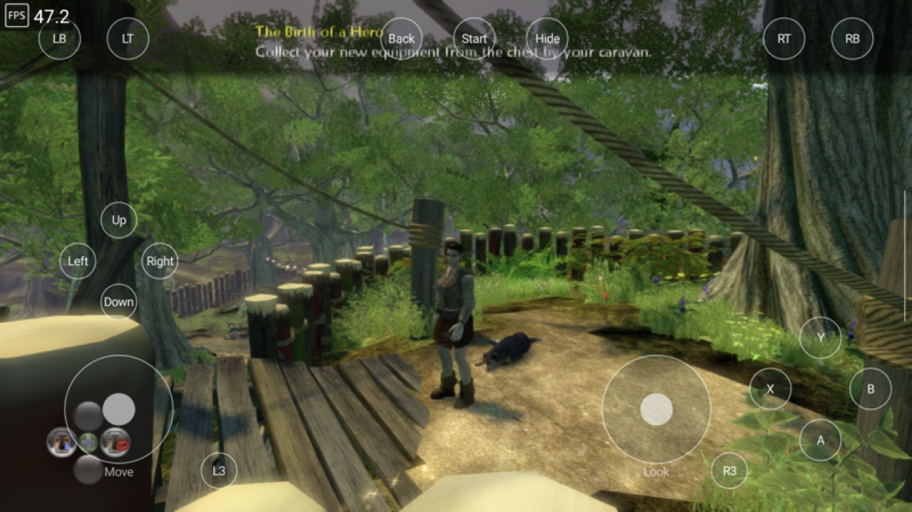
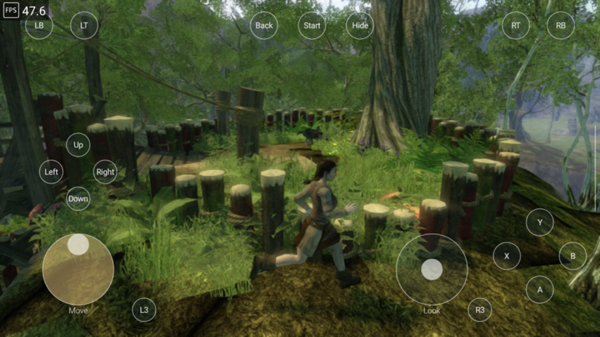
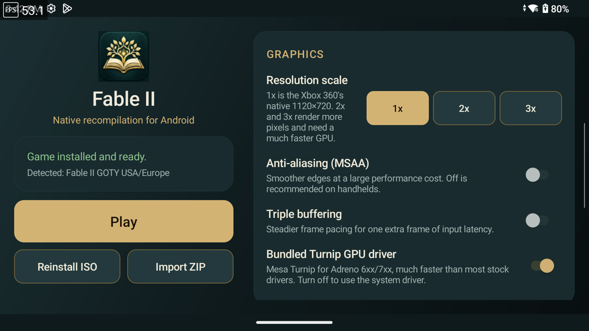
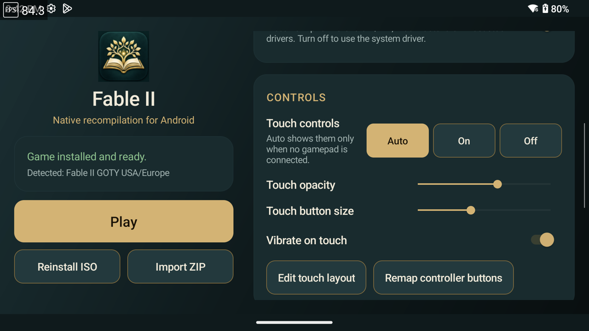
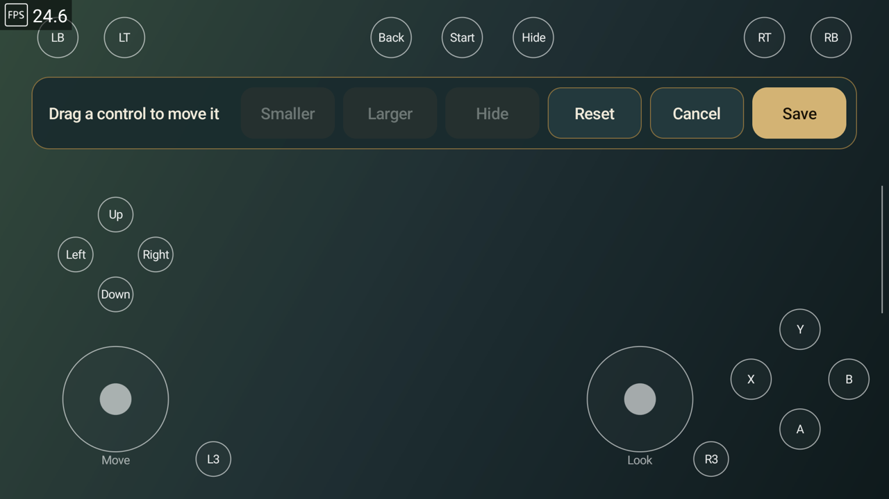
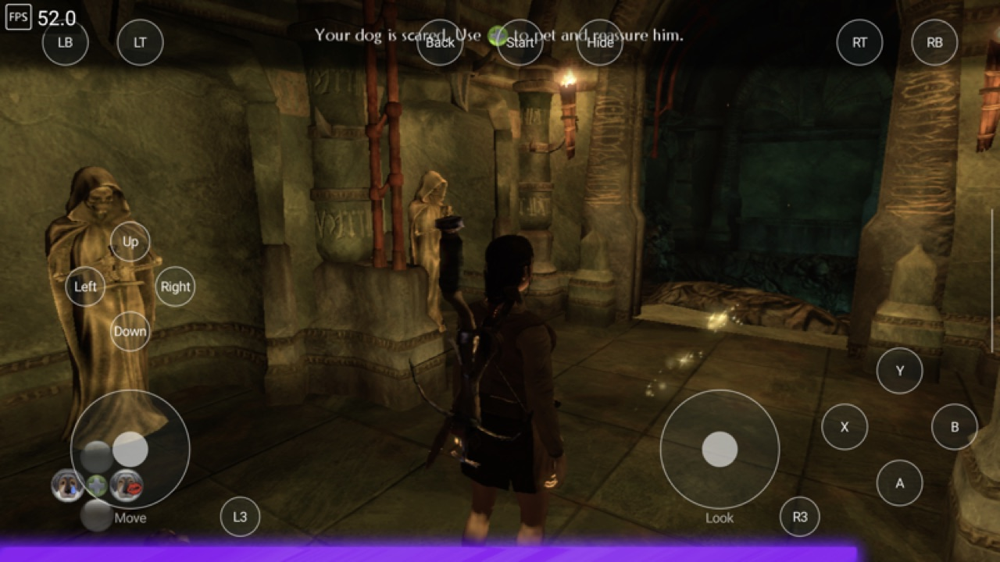

# FableDroid

**Fable II, running natively on Android.**

FableDroid is an Android port of the [Fable 2 ReXGlue recompilation](https://github.com/himdo/Fable-2-Recomp).
The game's Xbox 360 PowerPC code is statically recompiled to C++ and built for arm64.
Xbox 360 GPU commands are translated to Vulkan. Nothing is emulated instruction by
instruction: the game runs as a native Android app.

**Bring your own game.** FableDroid contains no game content. You supply a disc image
(ISO) of a Fable II version you own, and the launcher installs it on the device.

> This project does not condone piracy. Any mention of or link to pirated copies will
> be removed and will get you banned from the repository.

<p>
  
  
</p>

---

## Status

Playable. The game boots, loads saves and runs at its 30 FPS cap on a Snapdragon 8 Gen 2
handheld with the default settings. A handful of graphics bugs remain (see
[Known issues](#known-issues)). This is an early, unofficial fan project.

| | |
|---|---|
| Version | [1.0.0](https://github.com/hardsilinder/FableDroid/releases/latest) (pre-release) |
| Primary test device | AYN Thor, Snapdragon 8 Gen 2 / Adreno 740, Android 13 |
| Performance | Median 29.9 FPS at native 720p, game's 30 FPS cap |
| Game versions | Fable II Game of the Year: USA/Europe, Germany, France, Italy, Russia, Spain |

---

## What it can do

**Runs the game natively**
- Recompiled arm64 code with a Vulkan renderer tuned for Adreno 7xx.
- Holds the game's 30 FPS cap on an Adreno 740 at 1x resolution.
- Persistent shader and pipeline cache. Shaders compile once, then load at startup on
  later launches.
- Optional intro-video skip.

**Low input latency**
- Low-latency mode (on by default) lets the game queue at most one frame ahead of the
  GPU. That cut the measured frame-queue delay from 45–55 ms to about 33 ms, with no
  FPS loss at the 30 FPS cap.
- High tick rate (on by default) doubles the game's input/logic update rate
  (15 → 30 Hz, and 30 → 60 Hz for the fast tick). Before this, the 15 Hz tick was the
  biggest source of input delay.
- MAILBOX presentation, and controller input is polled within about 4 ms.

**Graphics**
- FXAA plus a dithered alpha pattern for grass and foliage, at about the same image
  quality as the game's own MSAA and much faster on mobile GPUs.
- Resolution scale 1x (native 1120×720), 2x and 3x.
- Optional MSAA and triple buffering.
- GPU driver manager: bundled Mesa Turnip, the system driver, or verified Turnip
  downloads.

**Launcher**
- Installs straight from an Xbox 360 ISO on the device. No PC or extraction tools needed.
- Detects the game version (SHA-256 of `default.xex`) and warns about unsupported discs.
- Checks free space and shows progress. Cancelled or failed installs never leave a
  half-installed game or touch your saves.
- One-tap save backup to a ZIP anywhere you choose.
- Works with touch or a gamepad.

**Controls**
- Built-in handheld controls, Bluetooth and USB gamepads work out of the box.
- Controller button remapping.
- On-screen touch controls: two sticks, ABXY, D-pad, bumpers, analog triggers,
  stick clicks, Start and Back.
- Touch layout editor: drag, resize (50–250%) or hide any control.
- Touch mode Auto: touch controls hide when a gamepad connects and return when it
  disconnects.

**Audio**
- Forced stereo output, so dialogue isn't lost in Android's 5.1 downmix.

<p>
  
  
  
</p>

---

## Requirements

| | |
|---|---|
| Android | 12 (API 31) or newer, 64-bit (arm64-v8a) |
| GPU | Vulkan 1.1+. Adreno 7xx strongly recommended (Snapdragon 8 Gen 1 or newer) |
| RAM | 8 GB minimum, 12 GB+ recommended |
| Storage | About 7 GB for the game files, plus the ISO while installing (about 7.8 GB) |
| Game | An ISO of a supported Fable II version (below) |

### Supported game versions

| Version | Supported |
|---|---|
| Game of the Year: USA/Europe | Yes (primary test version) |
| Game of the Year: Germany, France, Italy, Russia, Spain | Yes |
| German retail / Title Update 1 | No |
| Japan, Asia, Latin America | No |

The reference disc is GOTY USA/Europe, ISO SHA-256
`685a0d3bea9718812f17bcd155907a5359a548b6d3d8342dd2a6c944f45e35ff`. Other dumps of
the same version work as long as `default.xex` matches; the launcher shows which
version it detected.

---

## Installing

No PC or build tools needed.

1. **Download the APK** from the [latest release](https://github.com/hardsilinder/FableDroid/releases/latest)
   (`FableDroid-1.0.0.apk`) on your device and open it. Allow installing from your browser
   or file manager if Android asks.
2. **Copy your Fable II ISO to the device**, for example into `Download`, over USB,
   microSD or a network share.
3. **Open the app** (it appears as *Fable II*), tap **Select game ISO** and choose the file.
   Installing takes from about 10 seconds to a few minutes depending on storage speed.
4. When the status card says the game is ready, tap **Play**.

You can delete the ISO afterwards. The game files live in the app's own storage.

**Updating:** install the new APK over the old one. Game files, saves and settings are kept.
**Uninstalling deletes everything, including saves.** Use **Back up saves** first.

> **Non-Adreno GPUs (Mali, Xclipse, PowerVR):** open **GPU drivers / downloads** and choose
> **System driver**. The bundled Turnip driver only supports Adreno.

Full settings, controls, file locations and troubleshooting:
[android/README.md](android/README.md).

---

## Hardware testing

| Device | SoC / GPU | Android | Result |
|---|---|---|---|
| **AYN Thor** | Snapdragon 8 Gen 2 / Adreno 740 | 13 | **Main test device.** Boots, loads saves, plays. Median 29.9 FPS at 1x (30 FPS cap), frame-queue delay about 33 ms, occasional 38–54 ms frames. |
| **OnePlus Open** | Snapdragon 8 Gen 2 / Adreno 740 | 16 (API 36) | Boots and plays on the cover display with touch controls, no crashes. Tested on 2026-10-22, before the latest graphics fixes; not re-benchmarked since. |

Other Snapdragon 8 Gen 2 / 8 Gen 3 devices (AYN Odin 2, Retroid Pocket 5, Galaxy S23/S24,
OnePlus 11/12…) should behave similarly but haven't been verified. Reports are welcome.

### How performance was measured
All Thor numbers come from the same save and the same scripted route (walking and turning
the camera in the opening forest), sampled over ten 5-second windows after the shader
cache was warm, with saves backed up and restored around every run. Settings: 1x
resolution, MSAA off, FXAA on, low latency on, high tick rate on, bundled Turnip.

The biggest wins on the way from about 15 FPS to the 30 FPS cap. Each was measured
against the build just before it; the benchmark route was tightened along the way, so
numbers from different rows aren't directly comparable.

| Change | Before → after (FPS) |
|---|---|
| Shader: relaxed zero-multiply handling | 14.6 → 17.1 |
| Shader: implicit-LOD texture sampling | 17.1 → 18.1 |
| Shader: cheaper texture-fetch format handling | 20.3 → 21.5 |
| Game MSAA off, replaced by FXAA + dithered foliage | 21.7 → 26.9 |
| Upload-first texture path | 26.9 → 29.6 |
| Skip useless render-target copies before full-screen clears (movement route) | 23.7 → 29.6 |

The GPU is still about 97% busy at 30 FPS, so 2x and 3x resolution are far from playable
on current handhelds. Details: [docs/ANDROID_PERFORMANCE.md](docs/ANDROID_PERFORMANCE.md).

---

## Known issues

**Graphics**
- **Hero and dog skin morphing is off by default.** Fable II builds aged, scarred and
  tattooed skin textures on the GPU. A shader translation bug turned these textures
  black; it is fixed (the texture exponent was read from the wrong fetch-constant word),
  but morphing stays off until the remaining side effects below are cleared. With it
  off, the hero and dog use their base skin.
- **Black items in the "take item" preview** (opening a chest) were reported on
  2026-10-29. The exponent fix above may cover it, but it hasn't been confirmed yet.
- **Purple strip along the bottom of the screen** in some scenes, and corrupted lower
  screen when the camera is pressed against a wall.
- **Jumbled loading-screen text** seen in some runs with morphing on.
- Morphing on only: the face can look slightly off, and makeup is not rendered correctly
  (same limitation as the Xenia patch this setting is based on).

**Performance**
- Occasional slow frames of 38–54 ms while the GPU is near its limit.
- Short hitches the first time an area is visited while shaders compile. They go away
  once cached.
- 2x and 3x resolution are experimental and well below playable speed.

**Other**
- Uninstalling the app deletes saves. Back up first.
- Triggers and sticks can't be remapped.
- Only the versions in the table above are supported; others crash or misbehave.

<p>
  
  <br><sub>A dungeon on the Thor. The purple strip at the bottom edge is a known bug.</sub>
</p>

---

## Building from source

Only needed if you want to change the code. You need a Mac (Apple Silicon) or Linux host, the Android SDK with NDK
**29.0.14206865**, CMake 3.25+, Ninja, JDK 21, Python 3, and a supported `default.xex`
in the project root (code generation reads it at build time).

The ReXGlue SDK submodule is stock `rexglue-sdk` plus this project's Android changes in
[`thirdparty/rexglue-sdk-android.patch`](thirdparty/rexglue-sdk-android.patch): Android
platform support, Vulkan backend fixes and performance work, the shader-cache fix, the
texture exponent fix, low-latency frame pacing, forced stereo audio, and libadrenotools
for custom driver loading.

```sh
git clone https://github.com/hardsilinder/FableDroid.git
cd FableDroid
git submodule update --init --recursive
git -C thirdparty/rexglue-sdk apply ../rexglue-sdk-android.patch
```

Then follow [android/README.md → Building from source](android/README.md#building-from-source):
build the host code generator and the Android runtime, build the game library, and package
the APK with Gradle.

---

## Credits and licenses

- **Fable II** © Microsoft / Lionhead Studios. FableDroid is an unofficial fan project,
  not affiliated with or endorsed by Microsoft. No game content is distributed.
- **[Fable 2 ReXGlue recompilation](https://github.com/himdo/Fable-2-Recomp)** by Himdo:
  the desktop recompilation FableDroid is built on. Its original README is in
  [docs/FABLE2_RECOMP_README.md](docs/FABLE2_RECOMP_README.md).
- **[ReXGlue SDK](https://github.com/rexglue/rexglue-sdk)**: recompiler and runtime.
- **Xenia**: reference for Xbox 360 GPU behaviour, and the "Disable Texture Morphing"
  game patch.
- **Mesa Turnip** (MIT), **libadrenotools** (BSD 2-Clause, © Billy Laws), **SDL3** (zlib).
- This project's own code is under the MIT license in [LICENSE](LICENSE).
